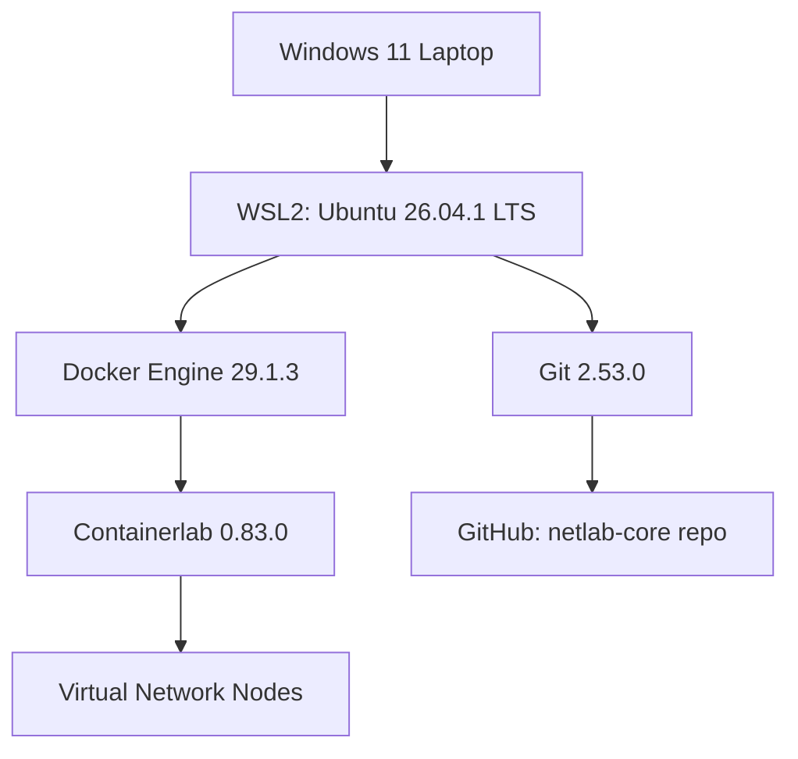

# L1 — Home Lab Build & Documentation

**Owner:** Ronique Young
**Date built:** 2026-09-15
**Environment type:** Virtualized (Windows laptop, no physical lab hardware yet)
**Hardware:** ~8 GB RAM - limits how many router nodes can run at once (lightweight FRRouting nodes preferred)
**Last updated:** 2026-11-15

## Stack

| Layer | Component | Version |
|---|---|---|
| Host OS | Windows 11 (laptop) | — |
| Linux layer | WSL2 — Ubuntu | 26.04.1 LTS ("resolute") |
| Kernel | Linux | 6.18.33.2-microsoft-standard-WSL2 |
| Container runtime | Docker | 29.1.3 |
| Network lab platform | Containerlab | 0.83.0 |
| Version control | Git | 2.53.0 |

## Topology

## Access

Local terminal only (Ubuntu app / Windows Terminal on the host laptop). No remote/SSH access configured yet — this is a single-user local lab environment.

## How to rebuild this from zero

1. On Windows, open PowerShell as Administrator, run `wsl --install`, restart.
2. If Ubuntu doesn't install automatically, run `wsl --install -d Ubuntu`.
3. On first launch, create a Linux username and password.
4. Update packages: `sudo apt update && sudo apt install -y git`
5. Install Docker and Containerlab: `curl -sL https://containerlab.dev/setup | sudo -E bash -s -- all`
6. Enable and start Docker (Ubuntu's `docker.io` package, 29.1.3): `sudo systemctl enable --now docker`
7. Add yourself to the `docker` and `clab_admins` groups: `sudo usermod -aG docker,clab_admins $USER`, then close and reopen the terminal.
8. Clone the lab repo: `git clone https://github.com/Ronique-TheYoungTech/netlab-core.git`

## What broke and how I found it

**Symptom:** Running `curl -sL https://containerlab.dev/setup | sudo bash` completed instantly with no output and installed nothing.

**Hypothesis 1:** Network/DNS issue blocking the download. Tested by running `curl` alone without piping to bash — the script downloaded fine, full contents visible. Rejected.

**Hypothesis 2:** The install script requires an explicit function name as an argument (its structure ends in `"$@"`, meaning it only runs a function if one is passed in). Confirmed by re-running with `sudo bash -s -- all`, which triggered the full install (Docker, Containerlab, etc.) and worked.

**Root cause:** Piping curl output directly into `sudo bash` with no arguments left `$@` empty, so the script's dispatcher had nothing to execute.

**Fix:** `curl -sL https://containerlab.dev/setup | sudo bash -s -- all`

**Lesson:** A shell script ending in `"$@"` is designed to receive a command/function name as an argument — always check for that pattern before assuming a piped install script runs everything by default.

## Verification

Deployed a 2-node test topology (Alpine Linux containers) via Containerlab to confirm the full stack works end-to-end:

Both nodes reached `running` state with assigned IPs (172.20.20.2, 172.20.20.3). Verified connectivity:

Result: 4 packets transmitted, 4 received, 0% packet loss.

### Toolchain checks (re-verified 2026-11-15)

- `containerlab version` → 0.83.0
- `docker run --rm hello-world` → "Hello from Docker!"
- `docker ps` (no sudo) → empty table, no permission error

## Known issues

- `sudo apt update` shows 404 errors for `netdevops.fury.site ... Translation-en`. Harmless: the Containerlab apt repo doesn't publish translation files; package lists still download.
