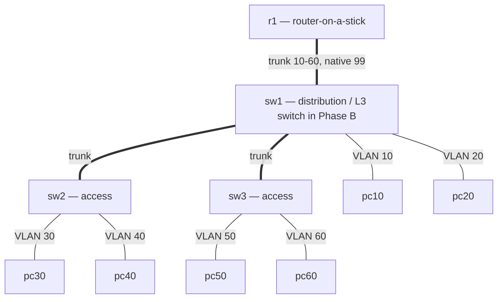

# L4 — VLANs, 802.1Q Trunking, Inter-VLAN Routing

**APEX Lab Ladder · Tier 0 · YoungTech** — six VLANs across three switches, 802.1Q trunks with the native VLAN moved off VLAN 1, and inter-VLAN routing done two ways: router-on-a-stick, then SVIs on a layer-3 switch.

## Topology



## VLAN and IP plan

| VLAN | Role | Subnet | Gateway | Host | Switch / port |
|---|---|---|---|---|---|
| 10 | Data | 10.0.10.0/24 | 10.0.10.1 | pc10 — 10.0.10.10 | sw1 / sw1-pc10 |
| 20 | Voice | 10.0.20.0/24 | 10.0.20.1 | pc20 — 10.0.20.10 | sw1 / sw1-pc20 |
| 30 | Servers | 10.0.30.0/24 | 10.0.30.1 | pc30 — 10.0.30.10 | sw2 / sw2-pc30 |
| 40 | Mgmt | 10.0.40.0/24 | 10.0.40.1 | pc40 — 10.0.40.10 | sw2 / sw2-pc40 |
| 50 | Guest | 10.0.50.0/24 | 10.0.50.1 | pc50 — 10.0.50.10 | sw3 / sw3-pc50 |
| 60 | Printers | 10.0.60.0/24 | 10.0.60.1 | pc60 — 10.0.60.10 | sw3 / sw3-pc60 |
| 99 | Native (untagged on trunks) | — | — | none | all trunks |

Gateway lives on **r1** subinterfaces in Phase A and on **sw1** SVIs in Phase B.

## Environment

Windows → WSL2 Ubuntu → Docker + Containerlab v0.83.0 → Alpine Linux nodes. Switches are Linux VLAN-aware bridges (`vlan_filtering 1`). Links are direct veth pairs created by `deploy.sh`.

## Rebuild from zero

```bash
sudo apt install -y tcpdump          # once
sudo ./deploy.sh                     # Phase A: router-on-a-stick
sudo ./matrix.sh phaseA              # 6x6 ping matrix
sudo ./capture.sh                    # tagged vs untagged frames
sudo ./phaseB-svi.sh                 # Phase B: SVIs on sw1
sudo ./matrix.sh phaseB
sudo containerlab destroy -t l4.clab.yml --cleanup
```

## Verification

### Phase A — router-on-a-stick
_Paste `results/matrix-phaseA.md` here._

### Phase B — SVIs
_Paste `results/matrix-phaseB.md` here._

### Packet capture
- `captures/trunk-sw1-r1.pcapng` — ICMP frames carrying 802.1Q tags (VLAN 10 and VLAN 20).
- `captures/access-sw1-pc10.pcapng` — the same traffic, untagged.
- _Add a screenshot of the Wireshark 802.1Q header here._

## Failure log

### Session 1 — 2026-11-22 (original manual build, pc1 / pc2)

**Symptom:** pc1 (10.0.10.10) could ping its gateway 10.0.10.1 but not pc2 (10.0.20.10).

| # | Test | Result | Conclusion |
|---|---|---|---|
| 1 | `ip link show` on sw1 | `eth3` (plain) was in br20, not `eth3.20` | sw1 sent VLAN 20 **untagged** toward sw3 |
| 2 | Rebuilt sw1 uplink as `eth3.20` in br20 | pc1 → pc2 still failed | One fault fixed, another remains |
| 3 | `ping` r1 → pc2 | 3/3 success | VLAN 20 Layer 2 path is good. Fault is Layer 3 |
| 4 | `sysctl net.ipv4.ip_forward` on r1 | `= 1` | Router forwarding OK |
| 5 | `ip route` on pc1 / pc2 | `default via 172.20.20.1 dev eth0` | Hosts send off-subnet traffic to the **mgmt network** |
| 6 | Added `10.0.0.0/16 via` the VLAN gateway, on pc1 only | Still failed | Reply path from pc2 still broken |
| 7 | Same route on pc2 | **4/4, ttl=63** | Inter-VLAN routing working |

**Root cause 1 — trunk mismatch.** sw1 forwarded VLAN 20 untagged out `eth3` while sw3 expected tagged VLAN 20 on `eth1.20`. Cisco equivalent: access port on one end, trunk on the other. The checkpoint notes said `eth3.20` — **documentation drift**. The live config is the truth.

**Root cause 2 — wrong default gateway.** Containerlab installs a default route via its management network (172.20.20.1 on eth0). The intended gateway was never installed ("File exists"). Fixed with a more-specific route — longest prefix match, /16 beats /0 — keeping the out-of-band management path intact.

**Lessons:** troubleshoot bottom-up and divide and conquer. Verify live state, not notes. A ping needs **both** directions. TTL 64 → 63 proves a routed hop.

**Design changes for the rebuild:** one VLAN-aware bridge per switch instead of a bridge per VLAN, so native VLAN 99 is real. Direct veth cables named `A-B`, so no MAC mapping and no stray Docker 172.x addresses. One host per VLAN for a true 6×6 matrix. One-command rebuild.

### Session 2 — clean rebuild
_Log anything that breaks during `deploy.sh` / `phaseB-svi.sh` here._

## Interview summary

_Problem → design → implementation → verification → failure analysis → lessons, in 6 sentences._

**Reading:** Odom, *CCNA 200-301 Official Cert Guide Vol. 1* — VLANs, trunking, inter-VLAN routing chapters.
