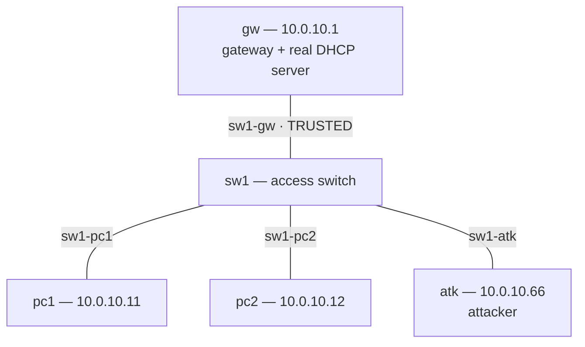

# L5 — Switchport Security Suite

**APEX Lab Ladder · Tier 0 · YoungTech** — attack my own switch, capture the attacks working, enable defenses, then capture the same attacks failing.

## Topology



## Attacks and defenses

| Attack | Defense | How it's built here | Cisco equivalent |
|---|---|---|---|
| Rogue DHCP server | DHCP snooping | `tc flower` drops UDP source port 67 on untrusted ports | `ip dhcp snooping` + `ip dhcp snooping trust` |
| ARP spoofing (MITM) | Dynamic ARP Inspection | `tc flower` passes only the port's bound IP/MAC in ARP, drops all other ARP | `ip arp inspection vlan 10` |
| MAC flooding / spoofing | Port security | Bridge port `locked on`, learning off, static FDB entry per port | `switchport port-security` |

**Why not Cisco features directly:** the free Linux nodes have no DHCP snooping, DAI or port security. The same logic is built from Linux bridge and `tc` primitives. Real switches implement these features as hardware ACLs that match packet fields, which is the same model.

## Prerequisites

```bash
sudo apt install -y dsniff dnsmasq-base iputils-arping nftables tcpdump
```

## Build

```bash
sudo ./deploy.sh
sudo ./nx pc1 ping -c 2 10.0.10.1
```

## Evidence

_Filled in during the lab: before/after captures for each attack._

## Failure log

### Session 1 — 2026-11-23/24 (preparing the platform)

| # | Problem | Cause | Fix / lesson |
|---|---|---|---|
| 1 | `apt` couldn't find `nftables`, and none of the 4 packages installed | Typo (`nfttables`); apt aborts the whole install if one name fails | Compare the name in the error with what you meant. Check the simple stuff first |
| 2 | `nft add table bridge` → `Operation not supported` | WSL2 kernel built without nftables bridge filtering | Checked before building. Switched to bridge `locked` ports + `tc flower` (all 4 features tested OK) |
| 3 | Pasted sudo block: `Authentication failed`, commands out of order | sudo's login had expired, and its password prompt swallowed the pasted lines | Run `sudo -v` before pasting multi-line sudo blocks |
| 4 | `"type" is invalid lladdr` | Test interface named `a`: iproute2 read it as the abbreviation for `address` | Never name interfaces after single letters or keywords |
